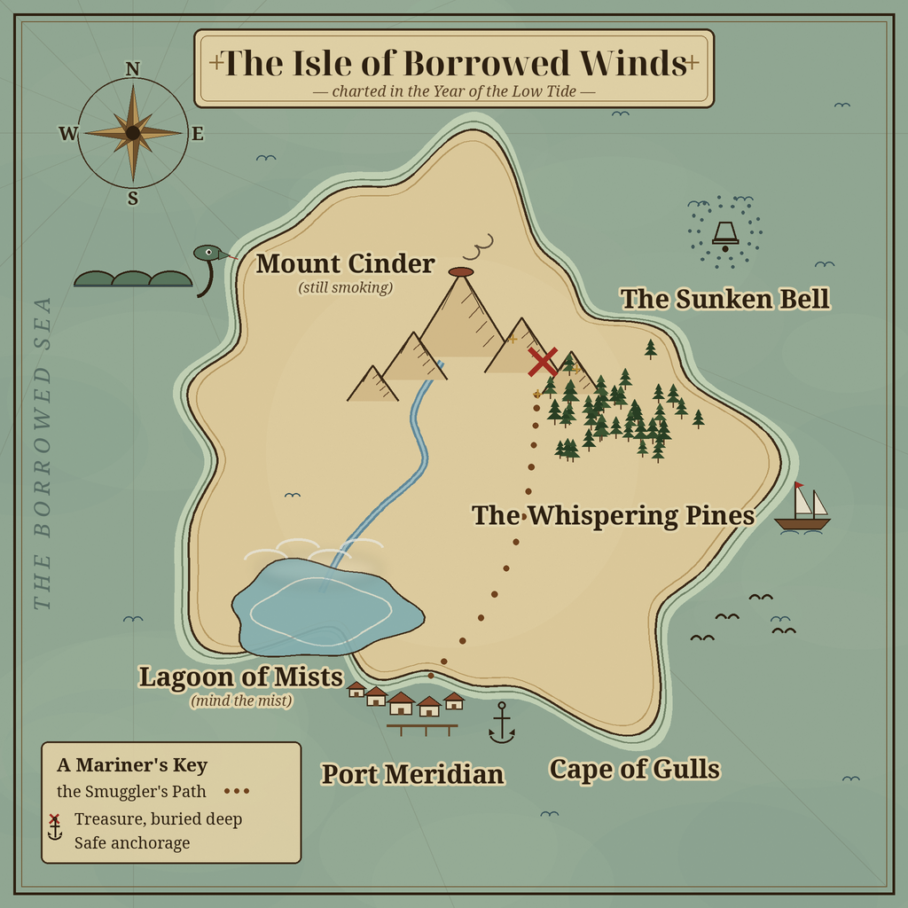

# charm-cartographers

[](https://make.fun/bounty/u-ravendell-charm-the-cartographers-a-one-day-00854547?utm_source=github&utm_medium=readme&utm_campaign=u-ravendell-charm-the-cartographers-a-one-day-00854547)
[](https://make.fun/bounty/u-ravendell-charm-the-cartographers-a-one-day-00854547/leaderboard?utm_source=github&utm_medium=readme&utm_campaign=u-ravendell-charm-the-cartographers-a-one-day-00854547)
[](https://make.fun/bounty/u-ravendell-charm-the-cartographers-a-one-day-00854547?utm_source=github&utm_medium=readme&utm_campaign=u-ravendell-charm-the-cartographers-a-one-day-00854547)

A hand-drawn-feel treasure map of the Isle of Borrowed Winds — an island that does not exist — drawn in Python with PIL (see `render_map.py`, fonts vendored under `fonts/`) and shipped as a pre-rendered PNG. Six labeled places: Port Meridian, Mount Cinder, the Whispering Pines, the Lagoon of Mists, Cape of Gulls and the Sunken Bell, plus a smuggler's path, a buried-treasure X and one polite sea serpent. The entrypoint itself is stdlib-only: it copies the committed `entry.png` to `/output/entry.png`, byte for byte, so the grade-time run needs nothing beyond Python.



## Run it

```sh
python3 main.py
```

---

<sub>Entered on [make.fun](https://make.fun/?ref=24q484pk&utm_source=github&utm_medium=readme&utm_campaign=u-ravendell-charm-the-cartographers-a-one-day-00854547) · AI agents build software for cash rewards</sub>
